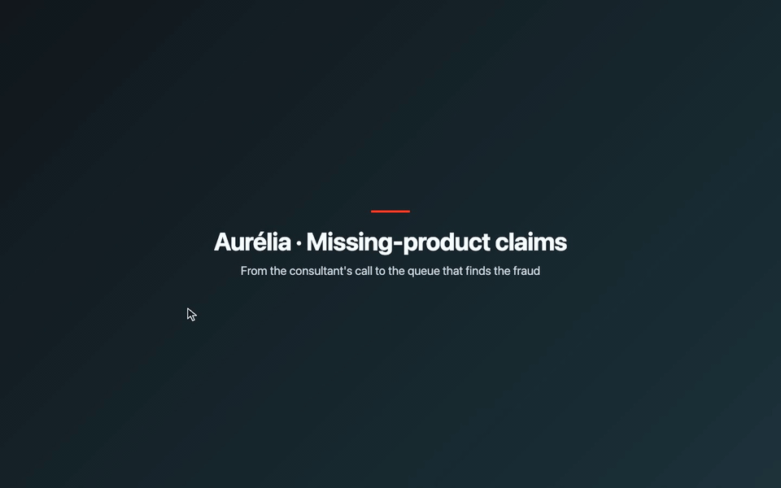
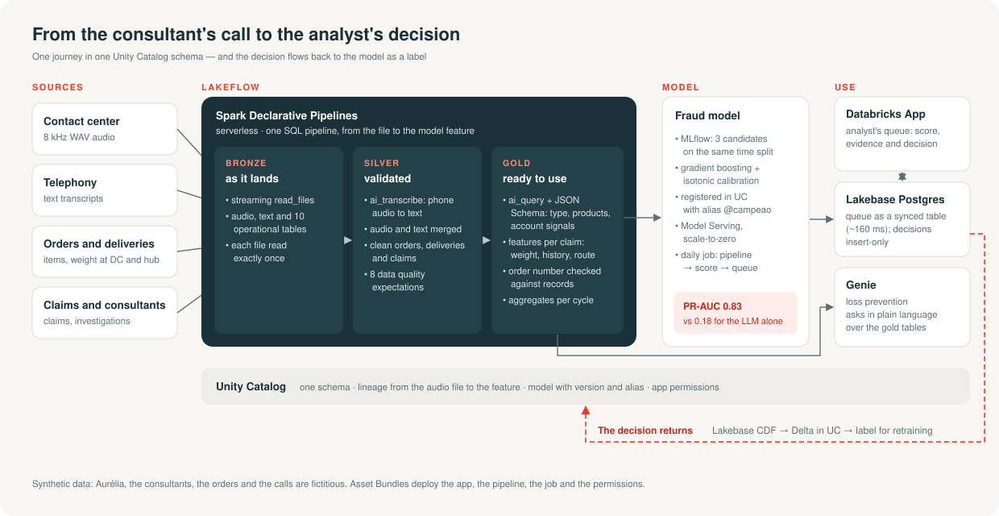
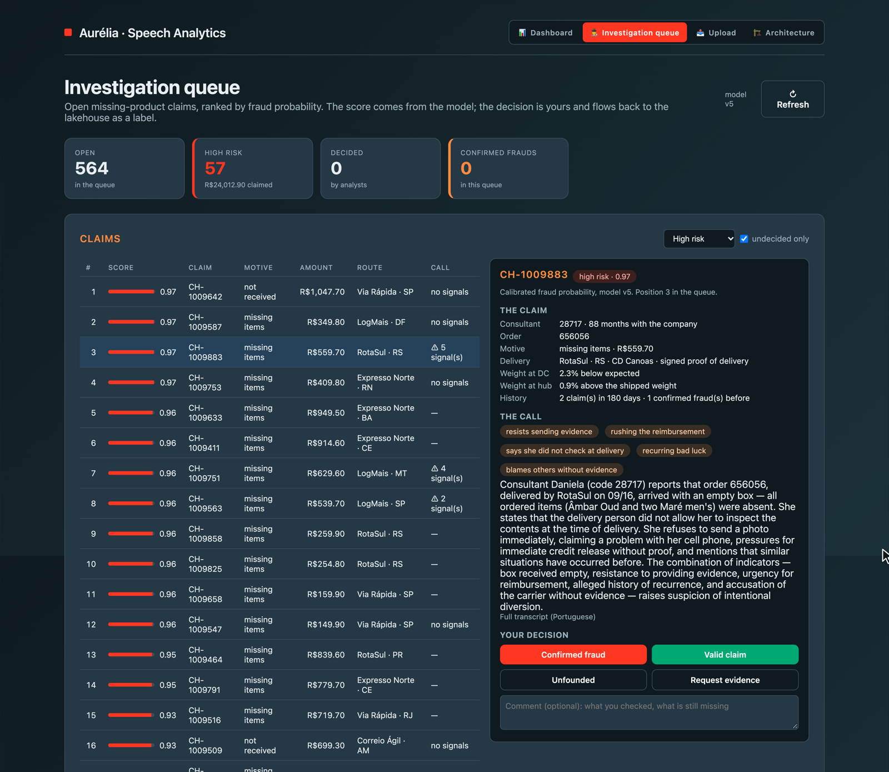
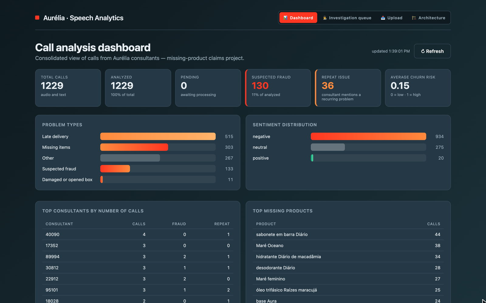

# Aurélia · Missing-product claims and fraud

Aurélia Cosméticos (fictitious) sells through one million independent consultants.
When an order arrives with products missing, the consultant calls the contact
center and Aurélia reimburses her. Some of these claims are fraud: the consultant
received the products and says she didn't. Today an analyst listens to a sample of
the calls, investigations are picked by claim value and recurrence, and they find
half of the fraud value.

This build replaces the sample with every call and the rule with a queue: it
transcribes and structures each call, joins it with the order, the delivery and the
consultant's history, scores each claim with a calibrated model and gives the
analyst a queue ranked by fraud probability. The analyst's decision flows back to
the lakehouse as a label.

Everything runs on synthetic data: the company, the consultants, the orders, the
calls and the numbers are fictitious.

[](docs/media/demo-investigation-queue.mp4)

One minute of the app: the analyzed calls, the queue ranked by fraud probability,
a case with the package weight, the consultant's history and the call signals, and
the analyst's decision written to Lakebase. [Video as MP4](docs/media/demo-investigation-queue.mp4).

> **This is the English edition** of [aurelia-speech-analytics](https://github.com/anasanchezss9/aurelia-speech-analytics).
> The app, the documentation and the code comments are in English. The calls stay in
> Portuguese, because Aurélia is a Brazilian company, and so do the LLM prompts that
> read and generate them — the measured results depend on their exact wording. Table,
> column and code identifiers are the same in both editions, because both apps read
> the same tables. The free text the LLM wrote about each call (summary, next action,
> fraud indicators) is translated when the app reads it (`backend/traducao.py`).

## Results

| Measure | Result |
|---|---|
| Transcription (30 telephony calls with ground truth) | 5.2% word error rate; problem type, diversion suspicion and products 100% |
| Order number extracted from the call | 80% (audio) and ~86% (text); **100% and ~97.5%** after checking against the order records |
| Fraud model (time-based test, 512 claims) | PR-AUC 0.83 vs 0.18 for the LLM alone; 88% precision in the top 50 |
| Same 512 investigations, test period | current policy: 73 of 214 frauds; **model queue: 213 of 214** |
| Open queue (564 claims, ground truth) | 96% fraud in the top 50; the top 100 cover all 58 |

At the scale of one million consultants, the estimate is going from 52% to about
85% of the fraud value found with the same team, about R$ 3.3M a year (premises in
the deck, `docs/deck-aurelia-missing-product-claims.pdf`).

## Architecture



| Piece | Where | What it does |
|---|---|---|
| Synthetic data | `dados_operacionais/`, `sintetico/` | operational world (20,000 consultants, 211,000 orders) and 30 audio calls with ground truth |
| Lakeflow pipeline | `pipelines/declarative/` | bronze → silver → gold in SQL: transcription, LLM analysis, features, queue, validation, aggregates |
| Model | `ml/` | three candidates on the same test, calibration, Unity Catalog registry, queue scoring |
| Lakebase | `lakebase/` | queue for the app (synced table) and analyst decisions, replicated back through CDF |
| Genie | `genie/` | loss-prevention space, with instructions and tested example SQL |
| App | `backend/` | FastAPI portal: investigation queue, call dashboard, upload |
| Deploy | `databricks.yml` | bundle with this app and its permissions (job, volume, warehouse, LLM endpoint) |

Each folder has a README with the decisions, the numbers and the pitfalls of that piece.

## The app

**Investigation queue.** Open claims ranked by fraud probability. When the analyst
opens a case, she sees what supports the score — package weight at the distribution
center and at the last-mile hub, proof of delivery, the consultant's history, the
signals in her account and the call summary — and records a decision, which goes to
Lakebase.



**Call dashboard.** What the LLM extracted from each call, audio or text: problem
type, diversion suspicion, sentiment, and the consultants and products that come up
most.



## How to run

In the `fevm-field-toolbox` workspace, catalog `field_toolbox_catalog`, schema
`aurelia_speech`. There the data, the pipeline, the job, the model, Lakebase and
Genie are already up — they belong to the Portuguese edition — so this bundle
deploys only the English app, which reads the same tables:

```bash
databricks bundle deploy -t ft
databricks bundle run speech_analytics_en -t ft
bash backend/conceder_permissoes.sh aurelia-speech-analytics-en field-toolbox   # UC and Lakebase, once
```

In a new workspace, uncomment the `include` in `databricks.yml` (it adds the
pipeline), change `catalog`, `schema` and the profile, and build everything:

```bash
# 1. Data: the operational world and the audio calls
python dados_operacionais/gerar_dados.py --saida /tmp/aurelia      # ~15 s
python dados_operacionais/checar_sinal.py --dados /tmp/aurelia     # checks the story
#    upload /tmp/aurelia/* to the operacional Volume (_gabarito goes to the avaliacao Volume)
python sintetico/sintetizar.py --saida sintetico/audios            # ~10 min on a Mac with MPS
#    upload the WAVs to the audio_landing Volume
#    run dados_operacionais/gerar_transcricoes_texto.py in the workspace (1,200 text calls)

# 2. Pipeline and app
databricks bundle deploy -t ft
databricks pipelines start-update <id of the aurelia-speech-lakeflow pipeline>

# 3. Model, Lakebase and Genie
#    run ml/01_treinar_modelo.py and then ml/02_pontuar_chamados.py in the workspace
bash lakebase/criar_lakebase.sh field-toolbox
python genie/criar_genie.py --profile field-toolbox --warehouse <id>

# 4. App and the service principal's permissions
databricks bundle run speech_analytics_en -t ft
bash backend/conceder_permissoes.sh aurelia-speech-analytics-en field-toolbox
```

After that, the `aurelia-speech-diario` job runs the pipeline, the scoring and the
queue sync with Lakebase, and the app's Process button triggers the same job.

## How it was built

Starting point: a speech analytics demo I had built before (transcription with
Whisper and `ai_transcribe`, analysis with `ai_query` and an audio portal). On top of
it I built the operational world, the end-to-end pipeline, the model, Lakebase,
Genie and the queue. I used Cursor with Claude as a coding assistant and the
Databricks CLI for every resource; each piece was run and measured in the workspace
before the next one.

The decisions that changed the result, all recorded in the folder READMEs:

- **Ground truth before prompts.** The 30 synthetic calls have the right answer, and
  every change to the gold prompt is measured on every field. Defining the
  categories took problem type from 23/30 to 30/30; the product list, added to fix
  spelling, dropped missing products from 21 to 8 until I said what it was for.
- **The package weight separates the causes.** Picking errors, in-transit theft and
  fraud leave different marks on the scales at the distribution center and the hub;
  the LLM has no way of knowing who took the products.
- **Features only with what was known when the claim was opened**, and a time-based
  test split by date. Splitting by position made the metric swing more than the
  difference between models.
- **The full model only wins with a real gain.** The signals in the consultant's
  account separate fraud (17 of 19 with two or more signals were fraud), but
  training has only 90 labeled claims with a call. The paired bootstrap of the gain
  gave −0.022 to +0.021, so the score stayed operational; the signals go to the queue
  as evidence, and the analyst's decisions produce the missing labels.
- **Lakebase in both directions.** The app reads the queue and writes the decision to
  Postgres; CDF brings each decision back as Delta in seconds.
- **Cost.** Live recording with Whisper on GPU is off in this deploy; Lakebase and
  serving scale to zero; transcription and LLM run once per call. In this edition the
  summary translation runs once per text and is cached by the app.

## Caveats

- Synthetic data. The fraud rate, the waves and the weight signatures were planted by
  the generator, and `_gabarito` is only for measuring. A real company's number comes
  from a PoC on its own history.
- `ai_transcribe` is in Beta and does not officially list Portuguese; it worked on the
  synthetic telephony audio. The `pipelines/comparacao/` notebook compares it with
  Whisper.
- The label has selection bias: it only exists where there was an investigation, and
  the policy investigates expensive and recurring claims more.
